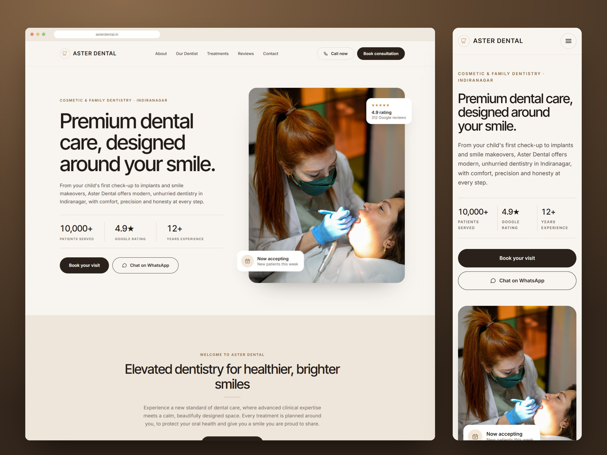

# Aster Dental — Astro dental clinic template

A warm, premium website for a dental clinic: split home hero, eight treatment detail pages, a dentist profile, reviews with a smile gallery, and a booking form that hands requests to WhatsApp.

## Commands

| Command           | Action                                      |
| :---------------- | :------------------------------------------ |
| `npm install`     | Install dependencies                        |
| `npm run dev`     | Start the dev server at `localhost:4321`    |
| `npm run build`   | Build the static site to `./dist/`          |
| `npm run preview` | Preview the production build                |

## Make it yours

Everything clinic-specific lives in `src/data/`. **All of it is demo content** (clinic, dentist, reviews, prices) and must be replaced before launch.

| File                       | What it holds |
| :------------------------- | :------------ |
| `src/data/site.ts`         | Name, address, phone/WhatsApp number, hours, rating, production URL, booking endpoint |
| `src/data/dentist.ts`      | Lead dentist profile: degrees, registration number, career, memberships, quote |
| `src/data/treatments.ts`   | One entry per treatment page (`/treatments/[slug]`): facts, prices, steps, FAQs, related treatments |
| `src/data/reviews.ts`      | Reviews and the star breakdown. Use real reviews, with the reviewer's permission |
| `src/data/photos.ts`       | Stock photos (Pexels) and the sample before/after pairs |

Also update `site` in `astro.config.mjs` to the production URL; it drives canonical links, social cards and the sitemap.

- **Phone and WhatsApp:** set `phone` in `site.ts` (digits only, with country code). The call links, WhatsApp chat links and displayed number all come from it. The demo number is a placeholder.
- **Photos:** replace files in `public/images` and update `alt` in `photos.ts`. The before/after images in `public/images/gallery` are AI-generated samples, labelled “Sample image”. Swap in consented patient cases and set `sample: false`.
- **Social card:** `public/og-image.jpg` (1200×630) is shared on WhatsApp, Facebook, LinkedIn and X. Regenerate it with the clinic's own branding.
- **Map:** `src/components/MapPlaceholder.astro` marks where the Google Maps `<iframe>` goes.

## Appointment form

The form on `/contact` validates name, Indian mobile number and consent, then:

- **Without a backend (default):** shows a summary and a “Send on WhatsApp” button that opens a chat with every detail pre-filled.
- **With a backend:** set `bookingEndpoint` in `site.ts` to any URL that accepts a JSON `POST` (Formspree, Web3Forms, your own API). The payload is `{ name, phone, reason, date, time, message }`. If the request fails, the patient sees an error with a pre-filled WhatsApp fallback.

Treatment pages link to `/contact?reason=…#book`, which preselects the matching reason.

## SEO

Each page sets its own title, description, canonical URL, Open Graph and Twitter tags, and breadcrumbs. Structured data (JSON-LD) includes `Dentist` (address, hours, rating), `Physician`, `MedicalProcedure`, `FAQPage` and `BreadcrumbList`. `/sitemap.xml` and `/robots.txt` are generated at build time.

## Promotional mockups

`promo/` holds ready-made marketing images (2400px wide):

- `showcase-desktop-mobile.jpg`: desktop home page beside the mobile version
- `devices-hero.jpg`: template title with the dentist page and a treatment page on a phone
- `mobile-screens.jpg`: four mobile screens
- `desktop-browser.jpg`: home page hero in a browser frame

## Credits

Photos from [Pexels](https://www.pexels.com) (free to use). Photographer credits are listed in `src/data/photos.ts`.
